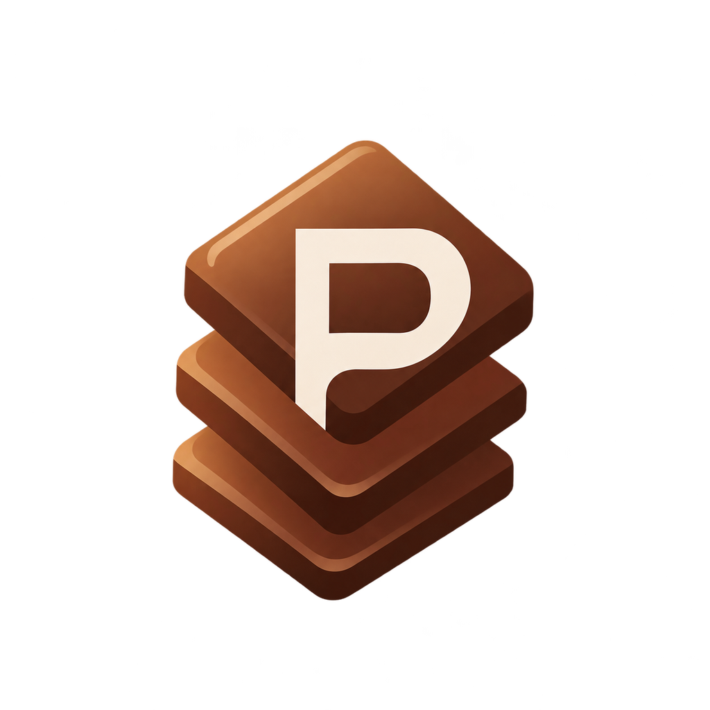

<div align="center">



<br />


<br />

[](./LICENSE)
[](https://www.typescriptlang.org/)
[](https://react.dev/)
[](https://supabase.com/)
[](https://tailwindcss.com/)
[](https://developer.mozilla.org/en-US/docs/Web/Progressive_web_apps)
[](https://pnpm.io/)

</div>

---

## 🍫 What it does

PataBin is a mobile-first PWA built for partners who buy chocolates in bulk, break them into packets, and resell piece by piece. The business runs in independent purchase lots (*chalans*): each lot is entered, settled, and closed — then the next one starts fresh.

| &nbsp; | &nbsp; |
| --- | --- |
| 💰 **Own-stock model** | Each partner pays for their own pieces from their own pocket. Whatever sells from a partner's packet — revenue and profit — belongs to that partner. |
| 📊 **Clear balances** | Per-partner balances ("who gets what from the cash pool") alongside shared wallet balances, with a full per-chalan settlement view. |
| 🧾 **Price snapshots** | Sales capture the listed sell price, the free-form final amount, and the derived discount — every entry stays auditable. |
| 🇧🇩 **Bangla UI** | The entire interface is in Bangla, with all strings collected in a single module so an English locale can be added later. |


---

## ✨ Features

| Area | What's inside |
| --- | --- |
| 🚚 **Chalans** | Bulk purchase entry with per-partner buy rows, buy rate, and editable packet size |
| 📦 **Packets** | Packing sessions, drag & drop sell-priority list (`@dnd-kit`), packet codes like `C-001/P-01` |
| 🧮 **Sales** | Auto-allocated across packets in priority order, pro-rata revenue split between owners |
| 🍽️ **Personal use** | Eating from another partner's packet records an internal credit to the owner |
| 🔁 **Stock adjustments** | Gifts, damage, loss, samples — traceable with person and note |
| 💸 **Expenses & withdrawals** | Category-managed records with manual attribution and optional chalan link |
| 👛 **Wallets** | Shared wallet accounts with per-partner and shared balances, payments received live |
| 🧑‍💼 **Administration** | `su_admin` settings: sell price, buy rate, packet size, expense categories |

<div align="center">

**Every state, designed — even the empty ones.**

<br />


</div>

---

## 🛠️ Tech stack

<div align="center">

**Frontend** &nbsp;


**Backend & Infra** &nbsp;


</div>

- **Frontend:** React 19, TypeScript, Vite, Tailwind CSS 4, React Router
- **Backend:** Supabase (Postgres, row-level security, generated schemas, edge functions)
- **PWA:** `vite-plugin-pwa` with Workbox — offline shell and installable app
- **Monorepo:** pnpm workspaces (`apps/web`, `packages/shared`, `supabase`)

---

## 📂 Project structure

```text
patabin/
├── apps/web/          # React PWA (UI, features, routes)
├── packages/shared/   # Shared types & Supabase-generated DB types
├── supabase/          # Migrations, functions, and labels (labels: config push)
├── scripts/           # Seed, backup, env, icon and config generators
└── docs/              # Production docs
```

---

## 🚀 Getting started

Prerequisites: **Node ≥ 20**, **pnpm 11**, and [Supabase CLI](https://supabase.com/docs/guides/local-cli).

```bash
# 1. Install dependencies
pnpm install

# 2. Local dev runtime (reads SECRETS.md, writes .env for the web app)
pnpm dev

# 3. Quality checks
pnpm lint
pnpm typecheck
pnpm test

# 4. Production build
pnpm build
```

> 🔐 Secrets live in `SECRETS.md` at the repo root — never commit it. Use `SECRETS.example.md` as the key reference. Secrets hygiene is enforced by `pnpm check:secrets`.

---

## 🧰 Useful scripts

| Command | Purpose |
| --- | --- |
| `pnpm db:link` / `pnpm db:push` | Link the Supabase project and apply migrations |
| `pnpm db:types` | Regenerate typed database schemas in `packages/shared` |
| `pnpm db:seed` / `pnpm db:backup` | Seed the cloud project / back up its tables |
| `pnpm gen:icons` | Regenerate PWA icons and brand assets with `sharp` |
| `pnpm gen:vercel` | Generate `apps/web/vercel.json` (headers, routes, caching) |
| `pnpm test:sql` / `pnpm check:routes` | SQL smoke tests / route integrity checks |

---

## 📚 Requirements & docs

The full product spec — domain model, accounting rules, agent workflow, and definition of done — lives in [REQUIREMENT.md](./REQUIREMENT.md). Production notes and operational guides are in [docs/](./docs/).

---

## 📜 License

Released under the **MIT License** — free to use, modify, and distribute.

Copyright © 2026 **Mohammad Sijan** ([sijan.pro.bd](https://sijan.pro.bd)) · **SpritexAI** ([spritexai.pro.bd](https://spritexai.pro.bd))

See [LICENSE](./LICENSE) for the full text.

---


